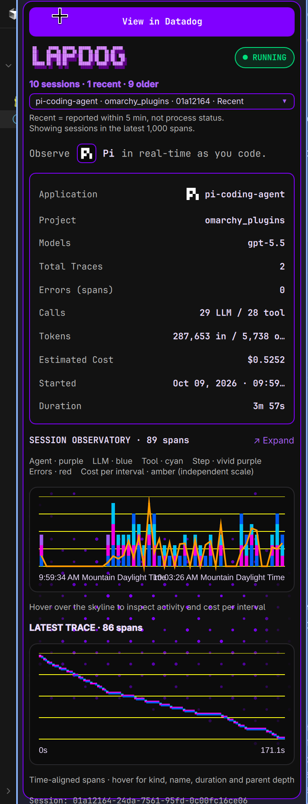

# Lapdog

Omarchy bar widget for local Datadog Lapdog / LLM Observability sessions. Visit lapdog.datadoghq.com to get started. No account needed.

It shows the current local Lapdog session state in the Omarchy bar, provides a rich popup with recent sessions, trace metrics, activity charts, and quick links into Datadog.



## Install

```bash
omarchy plugin add https://github.com/jasonhand/omarchy_datadog_lapdog.git --enable
```

If needed, rescan/restart the shell:

```bash
omarchy-shell shell rescanPlugins
# or
omarchy restart shell
```

Then add `datadog.lapdog` to your Omarchy bar layout if it was not enabled automatically.

## Remove

```bash
omarchy plugin remove datadog.lapdog
```

If installed manually, remove the plugin directory and rescan:

```bash
rm -rf ~/.config/omarchy/plugins/datadog.lapdog
omarchy-shell shell rescanPlugins
```

## Dependencies

- Omarchy Quattro shell / Quickshell
- Python 3 standard library
- Local Lapdog/Datadog Agent LLM Observability API on `http://127.0.0.1:8126`
- `xdg-open` for opening Datadog links
- Optional: a `LapDog.desktop` launcher for the right-click app shortcut

## Local data and configuration

The plugin reads local session data from the Lapdog/Datadog Agent API. It uses bundled assets and scripts with relative paths, so it can be installed under any Omarchy plugin directory.

The plugin does not overwrite user configuration.

## Validate

```bash
omarchy plugin validate .
```

## Marketplace submission

Suggested metadata:

- Category: `Widgets`
- Tags: `bar`, `quickshell`
- Maintainer notes: Runtime dependencies are documented above. The plugin does not overwrite user configuration.

## License

MIT. See [LICENSE](LICENSE).
